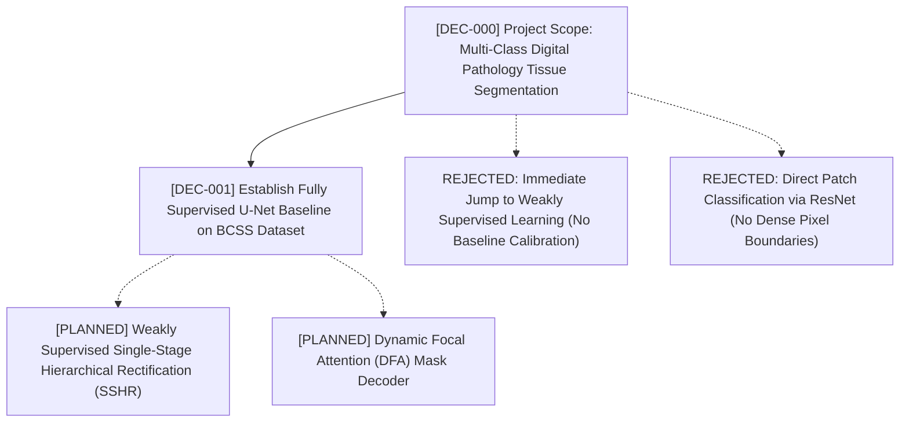

# Decision Graph

## Visual Graph (DAG)

---

## Decision Nodes

### [DEC-000] Project Scope & Core Architecture
* **Date:** 2026-11-04
* **Status:** Accepted (Dependencies: None)
* **Context:** Initializing Master's Thesis research in Computational Digital Pathology focused on multi-class tissue semantic segmentation on Whole Slide Images (WSIs).
* **Decision:** Formulate the research trajectory in two phases:
  1. Establish a rigorous, reproducible, fully supervised baseline (U-Net) on patch-level histopathology data.
  2. Advance towards weakly supervised semantic segmentation (WSSS) using Single-Stage Hierarchical Rectification (SSHR) with Hierarchical Feature Rectification Module (HFRM: Global-to-local Semantic Rectification + Cross-scale Homogenization) and Dynamic Focal Attention (DFA).
* **Rationale:** Direct processing of WSIs (up to 100,000 × 100,000 pixels, 10–20 GB per slide) is computationally intractable without tiling into patches. Establishing an empirical supervised ceiling is critical before introducing pseudo-label noise inherent to weakly supervised regimes.
* **Rejected Alternatives:**
  - *Direct End-to-End Gigapixel WSI Processing*: Prohibitively expensive memory footprint exceeding available GPU VRAM.
* **Consequences & Invariants:**
  - All training and validation pipelines must operate on deterministic patch extracts with strict patient-level separation to eliminate data leakage.

### [DEC-001] Establish Fully Supervised U-Net Baseline on BCSS Dataset
* **Date:** 2026-11-04 (Committee Meeting) / 2026-11-07 (Logged)
* **Status:** Accepted (Depends On: DEC-000)
* **Context:** In the thesis committee review meeting on November 4, 2026 (16:48 IST) with advisors Dr. Partha Pratim Sarangi and Dr. Deepak Ranjan Nayak (grounded in the connected `Thesis` NotebookLM source: *"Meeting started 2026/11/04 16:48 IST"*), the research team (Pragyan Prayas Jena and Ishuvi Misra) evaluated project milestones. While the ultimate thesis contribution targets weakly supervised and attention-based architectures, the committee directed the team to solve the problem as a fully supervised segmentation task first before tackling weak supervision.
* **Decision:**
  - Implement a standard symmetric encoder-decoder U-Net with skip connections and a 1×1 convolution segmentation head.
  - Target Dataset: BCSS (Breast Cancer Semantic Segmentation) containing 23,422 patches derived from 151 patients, with fixed train/val/test splits.
  - Task Formulation: 5-class semantic segmentation:
    1. Background (White background)
    2. Tumor Epithelium (TE)
    3. Tumor-Associated Stroma (Stroma)
    4. Lymphocytes / Inflammatory (Lymph)
    5. Necrosis (NEC)
  - Loss Formulation: Joint Cross-Entropy and Soft Dice Loss ($\mathcal{L} = \mathcal{L}_{\text{CE}} + \mathcal{L}_{\text{Dice}}$).
  - Primary Evaluation Metrics: Class-wise and Mean Dice Similarity Coefficient (DSC / F1) and Intersection-over-Union (mIoU / Jaccard). Target benchmark: $>0.70$ test mDice.
* **Why This Over Alternatives (Rationale):**
  - As emphasized by Dr. Deepak Ranjan Nayak, jumping straight into weakly supervised learning (e.g. CAM-based or point/box annotations) without a verified supervised baseline makes it impossible to diagnose whether segmentation errors stem from pseudo-label noise or architectural shortcomings.
  - Fully supervised U-Net establishes a definitive performance ceiling and provides a verified pipeline for data loading, stain augmentations, and metric computation.
* **Rejected Alternatives:**
  - *Directly Starting with Weakly Supervised Semantic Segmentation (WSSS)*: Rejected by Dr. Deepak Ranjan Nayak during the committee meeting due to high risk of compounding errors and lack of baseline calibration.
  - *Using Patch Classification Networks (e.g., standard ResNet)*: Rejected because patch-level classification outputs a single label per patch rather than spatial margin delineation of heterogeneous tissue boundaries.
* **Consequences & Invariants:**
  - BCSS patch dataset must be maintained as read-only with static CSV manifests (`train_manifest.csv`, `val_manifest.csv`, `test_manifest.csv`).
  - No patient overlap allowed across training, validation, and testing splits (patient-level partitioning across the 151 patients).
  - All experiments must execute via YAML configuration files and log Git SHA and seed metadata.

<!-- New decisions are appended below -->
