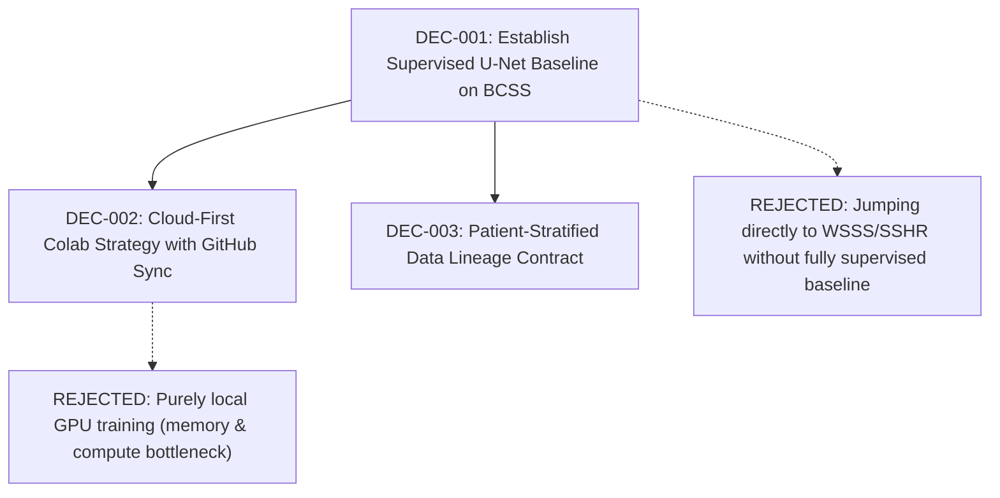

# Decision Graph & Session Memory

This document tracks all architectural choices, rejected alternatives, and rationale throughout the thesis research lifecycle.

---

## Decision Nodes

### [DEC-001] Establish Supervised U-Net Baseline on BCSS Dataset
* **Date:** 2026-11-07
* **Status:** Accepted (Supersedes: None | Depends On: None)
* **Context:** The long-term thesis investigates advanced Weakly Supervised Semantic Segmentation (SSHR) and Dynamic Focal Attention (DFA) on Whole Slide Images. However, during our initial committee review (Dr. Partha Pratim Sarangi and Dr. Deepak Ranjan Nayak), we aligned on first establishing a reliable, fully supervised baseline.
* **Decision:** Build and train a standard 5-class U-Net segmentation network on the BCSS (Breast Cancer Semantic Segmentation) dataset using Dice and Cross-Entropy loss.
* **Why This Over Alternatives (Rationale):**
  - Serves as the gold-standard benchmark against which weakly supervised methods will be judged.
  - Builds end-to-end competency in Whole Slide Image patch loading, metric evaluation (mIoU / mDice), and patient-level evaluation.
* **Rejected Alternatives:**
  - *Jumping directly to Single-Stage Hierarchical Rectification (SSHR):* Lacks an empirical control baseline to measure the degradation/gap of weak supervision.
  - *ResNet Backbone for classification:* ResNet alone is strictly a classification network; segmentation requires an encoder-decoder localization head.
* **Consequences / Invariants:** Requires BCSS patches and masks. Evaluation must report per-class Dice, mDice, and mIoU.

---

### [DEC-002] Cloud-First Colab Training Strategy with Local Git Sync
* **Date:** 2026-11-07
* **Status:** Accepted (Supersedes: None | Depends On: DEC-001)
* **Context:** Local training of deep segmentation models on 23,422 pathology patches requires substantial GPU memory and long runtimes.
* **Decision:** 
  - Code development, literature review, decision tracking, and LaTeX drafting occur locally in Antigravity.
  - Heavy model training runs on Google Colab (A100 / T4 GPUs) by cloning the GitHub repository.
  - Training metrics and lightweight logs (`metrics.json`) are committed back to GitHub.
  - Heavy model checkpoints (`*.pt`) are saved to mounted Google Drive storage, never committed directly to Git.
* **Why This Over Alternatives:**
  - Prevents local workstation thermal throttling while leveraging cloud accelerator compute.
  - Keeps git repository size lightweight (< 50 MB) while maintaining complete reproducibility.
* **Rejected Alternatives:**
  - *Committing heavy checkpoints directly to Git:* Causes repo bloat and exceeds GitHub file size limits (100 MB).

---

### [DEC-003] Patient-Stratified Data Lineage Contract
* **Date:** 2026-11-07
* **Status:** Accepted (Supersedes: None | Depends On: DEC-001)
* **Context:** In digital pathology, patches from the same patient or Whole Slide Image (WSI) share correlated tissue features and staining artifacts.
* **Decision:** Enforce strict patient-level splitting: all patches from a given patient ID must exist exclusively in either train, validation, or test set.
* **Invariants:** Zero patch leakage across splits. Splitting must be pre-computed and recorded as an immutable manifest (`patch_manifest.csv`).
