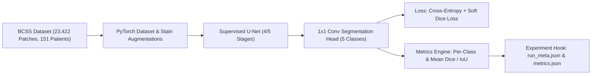

# System State & Invariants

## Current Architecture Snapshot

---

## Active Component Inventory

| Component | Responsibility | Current Status | Notes / Constraints |
| :--- | :--- | :--- | :--- |
| **Workspace & Memory** | Structured tree, Git repo, decision graph | **Active** | Baseline initialized [DEC-001] |
| **BCSS Data Pipeline** | Patch ingestion, static manifests, patient splits | Planned | Must strictly isolate 151 patients |
| **Augmentation Pipeline**| H&E stain jitter, flips, 90° rotations | Planned | Must preserve tissue morphological validity |
| **U-Net Architecture** | Encoder-decoder with skip connections, 5-class head | Planned | Socratic Guided Mode implementation |
| **Loss Modules** | Combined Cross-Entropy + Soft Dice Loss | Planned | Soft Dice requires Laplace smoothing ($\epsilon=1e-6$) |
| **Evaluation Engine** | Fast confusion matrix, per-class IoU & Dice | Planned | Vectorized PyTorch implementation |
| **Run Harness** | YAML configuration, seed locking, git dirty check | Planned | Zero-cluelessness run metadata |

---

## Hard Invariants (DO NOT BREAK)

1. **Patient-Level Split Isolation:** Patches originating from the same Whole Slide Image / patient must NEVER appear across both train and test/validation splits (zero patient leakage across the 151 patients).
2. **Deterministic 5-Class Ontology:**
   - `0`: White Background
   - `1`: Tumor Epithelium (TE)
   - `2`: Tumor-Associated Stroma (Stroma)
   - `3`: Lymphocytes / Inflammatory (Lymph)
   - `4`: Necrosis (NEC)
   Class indices must remain uniform across dataloaders, loss functions, and evaluation metrics.
3. **No Uncalibrated Jumps:** Do not implement weakly supervised modules (SSHR, CAMs, HFRM) until the fully supervised U-Net baseline is empirically verified on BCSS with test metrics logged.
4. **Reproducibility & Git Tracking:** Every training execution must automatically dump `run_meta.json` (git hash, dirty flag, full config snapshot, random seeds).
5. **Guided Learning Protocol:** The assistant operates as a mentor/tutor. Core architectural blocks, loss formulations, and metric calculators must be implemented via scaffolded, Socratic guidance rather than unreviewed monolithic dumps.

---

## Active Technical Debt & Unknowns

- [ ] **BCSS Local Storage & Download:** Locate and verify local path or download package for the 23,422 BCSS patches and ground truth masks.
- [ ] **Patient Split Verification:** Confirm the official patient-level partition lists (`train_slides.txt`, `val_slides.txt`, `test_slides.txt`) matching the 151 patient cohort.
- [ ] **Patch Dimension Invariant:** Confirm standard input resolution (1024×1024 vs downsampled 512×512) based on available compute/GPU VRAM.
